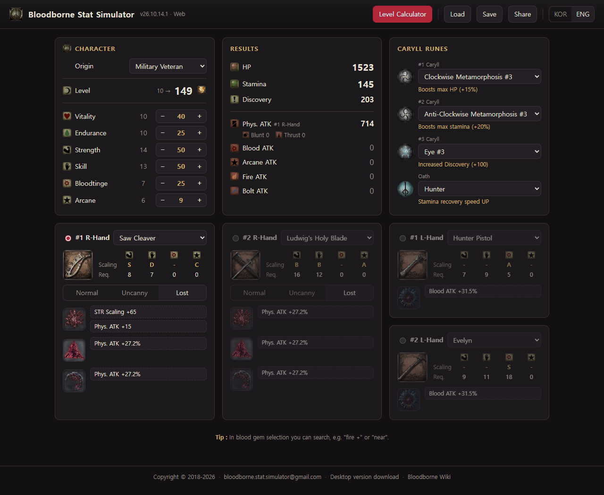
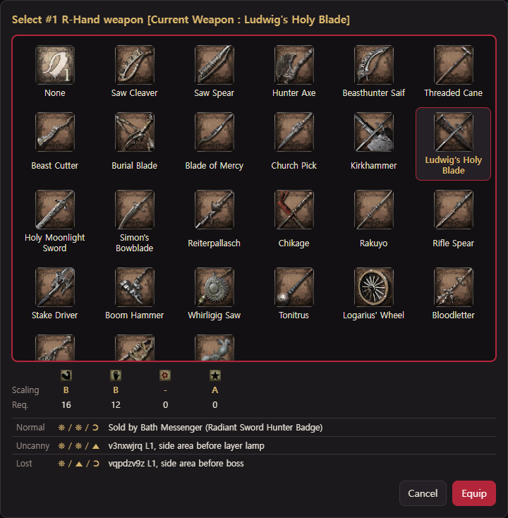
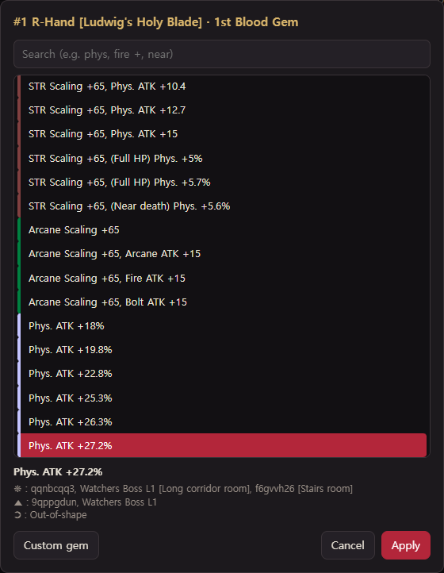
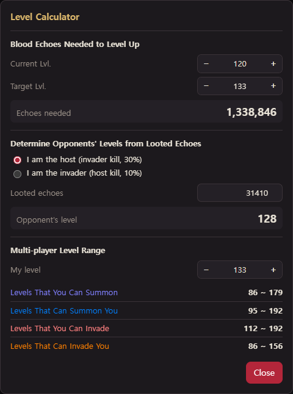

# Bloodborne Stat Simulator (Web)

An unofficial, fan-made stat and attack calculator for **Bloodborne** (PS4).
Plan your character build right in the browser — no installation, no server, works offline once loaded.

**▶ Open the simulator: https://game-simulator.github.io/bloodborne/**

## Features

- **Character stats** — origin, level, Vitality / Endurance / Strength / Skill / Bloodtinge / Arcane
- **Results** — HP, Stamina, Discovery, and Physical (Blunt / Thrust), Blood, Arcane, Fire, Bolt attack
- **Weapons** — two right-hand and two left-hand slots, Normal / Uncanny / Lost variants, scaling grades and stat requirements
- **Blood gems** — pick from the gem list (searchable) or enter custom values, with chalice glyphs for farming
- **Caryll runes** — three rune slots and an Oath rune
- **Level Calculator** — echoes needed to level up, an opponent's level from looted echoes, and multiplayer level ranges
- **Save / Load** — `.bss` files compatible with the desktop version
- **Share links** — copy a link that restores the whole build
- **Korean / English** — switch with the KOR / ENG buttons (or add `?lang=en` / `?lang=ko` to the address)

## Screenshots

<table>
  <tr>
    <td align="center" valign="top" width="33%"> Weapon selection — scaling, requirements and where to get Normal / Uncanny / Lost versions</td>
    <td align="center" valign="top" width="33%"> Blood gem selection — searchable list with chalice glyphs for farming</td>
    <td align="center" valign="top" width="33%"> Level Calculator — echoes needed, opponent's level and multiplayer level ranges</td>
  </tr>
</table>

## Desktop version

The original Windows desktop app (Korean / English) is available here: http://bit.ly/2FgXYJP

## About this repository

This repository hosts the published website only (GitHub Pages).
The code here is minified for distribution; the source code is not published.

## Disclaimer

This is an unofficial fan project and is not affiliated with, endorsed by, or sponsored by
Sony Interactive Entertainment or FromSoftware.
*Bloodborne* and all related names, images, and game data are trademarks or copyrighted material
of their respective owners and are used here for reference only.

Calculated values follow known game formulas and community data (e.g. [Bloodborne Wiki](https://www.bloodborne-wiki.com)),
and may differ slightly from in-game values.

## Copyright

Copyright © 2018-2026. All rights reserved (simulator code and design).
No license is granted to copy, modify, or redistribute the code in this repository.

## Contact

Bug reports and suggestions: bloodborne.stat.simulator@gmail.com
